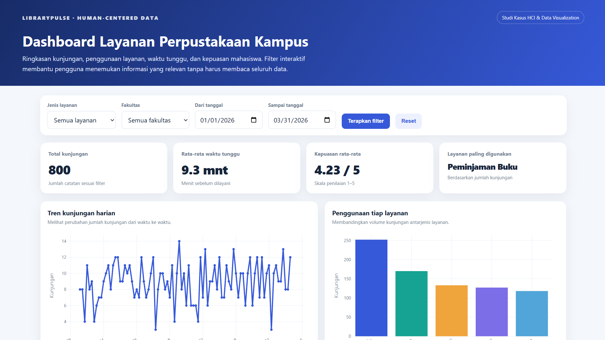

# Dashboard Interaktif Layanan Perpustakaan Kampus

## 1. Deskripsi Proyek

Proyek ini membahas penerapan konsep *Human-Computer Interaction (HCI)* dan *Data Visualization* dalam pengembangan dashboard interaktif menggunakan HTML, CSS, JavaScript, Python, dan Google Colab. Proyek ini disusun sebagai studi kasus penerapan prinsip interaksi manusia dan komputer untuk menyajikan informasi secara visual, terstruktur, dan mudah dipahami oleh pengguna.

Studi kasus yang diangkat adalah visualisasi data layanan perpustakaan kampus, yang mencakup jumlah kunjungan, jenis layanan yang digunakan, waktu tunggu, durasi pelayanan, serta tingkat kepuasan pengunjung. Dashboard dirancang untuk membantu pengguna memahami kondisi layanan perpustakaan melalui indikator utama, grafik interaktif, filter data, dan tabel rincian kunjungan.

Implementasi dashboard menggunakan HTML sebagai struktur halaman, CSS untuk mengatur tampilan antarmuka, dan JavaScript untuk mengelola interaksi serta memperbarui informasi berdasarkan filter yang dipilih pengguna. Visualisasi grafik dibuat menggunakan Plotly.js, sedangkan Python dan Pandas digunakan untuk menyiapkan dataset serta menghasilkan file dashboard HTML.

Melalui proyek ini, prinsip HCI diterapkan melalui hierarki visual, konsistensi tampilan, kemudahan penggunaan filter, umpan balik interaksi, dan desain responsif. Dashboard diharapkan dapat menyajikan informasi secara efektif sekaligus memberikan pengalaman penggunaan yang lebih nyaman.

## 2. Tujuan

- Memahami penerapan konsep Human-Computer Interaction (HCI) dalam pengembangan antarmuka dashboard.
- Memahami penerapan Data Visualization untuk menyajikan informasi secara visual.
- Mengolah dan menganalisis data kunjungan layanan perpustakaan menggunakan Python dan Pandas.
- Menampilkan indikator utama berupa total kunjungan, rata-rata waktu tunggu, rata-rata kepuasan, dan layanan paling banyak digunakan.
- Memvisualisasikan tren kunjungan harian dan perbandingan penggunaan layanan.
- Menampilkan hubungan antara waktu tunggu dan tingkat kepuasan pengunjung.
- Mengembangkan filter interaktif berdasarkan jenis layanan, fakultas, dan rentang tanggal.
- Menampilkan tabel rincian kunjungan yang menyesuaikan filter pengguna.
- Menerapkan prinsip desain antarmuka yang konsisten, responsif, dan mudah digunakan.
- Memahami proses pembuatan dashboard berbasis HTML, CSS, JavaScript, dan Google Colab.
- Menyiapkan dokumentasi proyek agar dapat dibagikan melalui GitHub.

## 3. Dataset

**Nama dataset:** Data Dummy Layanan Perpustakaan Kampus

**Sumber:** Data sintetis yang dibuat menggunakan Python dan NumPy untuk keperluan demonstrasi.

**Jumlah data:** 800 catatan kunjungan.

Dataset ini berisi informasi simulasi mengenai aktivitas pengunjung perpustakaan kampus. Data digunakan untuk menunjukkan bagaimana informasi layanan dapat diolah dan disajikan dalam bentuk dashboard interaktif.

Variabel yang digunakan dalam dataset meliputi:

- `date`: tanggal kunjungan perpustakaan.
- `service`: jenis layanan yang digunakan pengunjung.
- `faculty`: fakultas pengunjung.
- `time_slot`: rentang waktu kunjungan.
- `wait`: waktu tunggu sebelum memperoleh pelayanan dalam menit.
- `duration`: durasi pelayanan dalam menit.
- `satisfaction`: tingkat kepuasan pengunjung pada skala 1–5.

Jenis layanan yang ditampilkan meliputi peminjaman buku, pengembalian, keanggotaan, referensi, dan ruang diskusi.

Data tersebut digunakan sebagai bahan demonstrasi untuk pengolahan data, pembuatan grafik, dan pengembangan fitur filter pada dashboard. Seluruh data merupakan data sintetis, bukan data resmi perpustakaan maupun hasil survei terhadap pengunjung sebenarnya.

Oleh karena itu, hasil visualisasi hanya digunakan untuk keperluan pembelajaran dan tidak dapat dijadikan dasar untuk menyimpulkan kondisi nyata layanan perpustakaan.

## 4. Metode dan Tahapan Analisis

1. **Persiapan data**  
   Membuat dataset sintetis menggunakan Python, NumPy, dan Pandas yang berisi 800 catatan kunjungan perpustakaan.

2. **Pemeriksaan data**  
   Memeriksa struktur dataset, nama kolom, tipe data, dan nilai pada setiap variabel sebelum digunakan dalam dashboard.

3. **Pengolahan data**  
   Mengatur format tanggal, jenis layanan, fakultas, waktu tunggu, durasi pelayanan, dan tingkat kepuasan agar dapat digunakan dalam visualisasi.

4. **Perhitungan indikator utama**  
   Menghitung total kunjungan, rata-rata waktu tunggu, rata-rata kepuasan, dan jenis layanan dengan jumlah kunjungan terbanyak.

5. **Perancangan antarmuka**  
   Menyusun struktur dashboard menggunakan HTML dan mengatur tampilan menggunakan CSS, termasuk kartu indikator, panel grafik, filter, dan tabel.

6. **Pembuatan visualisasi**  
   Menggunakan Plotly.js untuk membuat grafik tren kunjungan harian, penggunaan layanan, hubungan waktu tunggu dengan kepuasan, dan rata-rata durasi pelayanan.

7. **Pengembangan interaksi**  
   Menggunakan JavaScript untuk mengatur filter jenis layanan, fakultas, dan rentang tanggal, serta memperbarui indikator, grafik, dan tabel berdasarkan pilihan pengguna.

8. **Penerapan prinsip HCI**  
   Menerapkan hierarki visual, konsistensi komponen, label filter yang jelas, umpan balik interaksi, fokus keyboard, dan desain responsif.

9. **Pengujian fungsi dashboard**  
   Memeriksa apakah filter dapat digunakan dan apakah informasi yang ditampilkan berubah sesuai data yang memenuhi kriteria filter.

10. **Pembuatan file HTML**  
    Menggabungkan struktur HTML, CSS, JavaScript, dan data sintetis ke dalam file `dashboard_perpustakaan.html`.

11. **Dokumentasi proyek**  
    Menyiapkan notebook Google Colab, file dashboard HTML, dataset CSV, dan README untuk dokumentasi serta publikasi proyek melalui GitHub.

12. **Analisis hasil**  
    Mengamati bagaimana dashboard membantu menyajikan informasi layanan perpustakaan melalui indikator utama, grafik, dan tabel yang saling terhubung.

## 5. Teknologi yang Digunakan

- **Python** — bahasa pemrograman untuk menyiapkan dan mengolah data.
- **Google Colab** — lingkungan berbasis cloud untuk menjalankan notebook Python.
- **HTML** — menyusun struktur halaman dashboard.
- **CSS** — mengatur tata letak, warna, tipografi, dan desain responsif.
- **JavaScript** — menangani filter, pembaruan indikator, grafik, dan tabel.
- **Pandas** — mengolah dataset dan menyusun data dalam bentuk tabel.
- **NumPy** — menghasilkan data sintetis untuk simulasi kunjungan perpustakaan.
- **Plotly.js** — membuat grafik interaktif pada dashboard.
- **GitHub** — menyimpan kode sumber, dataset, dokumentasi, dan file proyek.

## 6. Implementasi HCI dan Data Visualization

Implementasi proyek ini berfokus pada penyajian informasi layanan perpustakaan melalui antarmuka dashboard yang interaktif.

### A. Indikator Utama (KPI)

Dashboard menampilkan empat indikator utama:

- **Total Kunjungan:** jumlah catatan kunjungan sesuai filter.
- **Rata-rata Waktu Tunggu:** rata-rata waktu tunggu pengunjung sebelum memperoleh pelayanan.
- **Kepuasan Rata-rata:** nilai rata-rata kepuasan pada skala 1–5.
- **Layanan Paling Digunakan:** jenis layanan dengan jumlah kunjungan terbanyak sesuai filter.

Indikator ditempatkan pada bagian atas dashboard agar informasi utama dapat diketahui dengan cepat.

### B. Visualisasi Data

Dashboard menyediakan empat jenis visualisasi:

- **Tren Kunjungan Harian:** grafik garis untuk melihat perubahan jumlah kunjungan dari waktu ke waktu.
- **Penggunaan Tiap Layanan:** grafik batang untuk membandingkan jumlah kunjungan pada setiap jenis layanan.
- **Waktu Tunggu dan Kepuasan:** grafik sebar untuk mengamati pola hubungan antara waktu tunggu dan tingkat kepuasan.
- **Rata-rata Durasi Layanan:** grafik batang untuk membandingkan durasi rata-rata setiap jenis layanan.

Penggunaan grafik yang berbeda disesuaikan dengan jenis informasi yang ingin disampaikan sehingga data lebih mudah dibaca dan dibandingkan.

### C. Fitur Interaktif

Pengguna dapat memfilter data berdasarkan jenis layanan, fakultas, dan rentang tanggal. Setelah tombol **Terapkan Filter** dipilih, indikator utama, grafik, dan tabel akan diperbarui berdasarkan kriteria yang ditentukan.

Tombol **Reset** digunakan untuk mengembalikan filter ke kondisi awal. Fitur ini memungkinkan pengguna mengeksplorasi data tanpa harus membaca seluruh catatan secara manual.

### D. Penerapan Prinsip HCI

Beberapa prinsip HCI yang diterapkan dalam dashboard meliputi:

- **Hierarki visual:** informasi penting ditempatkan pada bagian atas halaman.
- **Konsistensi:** warna, komponen, label, dan pola interaksi dibuat konsisten.
- **Umpan balik:** hasil visualisasi diperbarui setelah pengguna menerapkan filter.
- **Kemudahan penggunaan:** filter diberi label yang jelas dan tabel menyediakan rincian data.
- **Desain responsif:** tata letak disesuaikan agar tetap nyaman digunakan pada layar desktop maupun perangkat berukuran kecil.
- **Aksesibilitas dasar:** elemen input memiliki label dan komponen interaktif menyediakan indikator fokus keyboard.

Penerapan prinsip tersebut merupakan bagian dari rancangan antarmuka. Pengujian usability formal dengan pengguna nyata masih diperlukan apabila ingin mengukur efektivitas dan kemudahan penggunaan secara empiris.

## 7. Tampilan Dashboard

*Gambar 1. Tampilan Dashboard Interaktif Layanan Perpustakaan Kampus.*

## 8. Cara Menjalankan Proyek

1. Buka Google Colab melalui [https://colab.research.google.com/](https://colab.research.google.com/).
2. Unduh atau siapkan notebook `Studi_Kasus_HCI_Visualisasi_Layanan_Perpustakaan_HTML.ipynb`.
3. Unggah notebook melalui menu **File → Upload notebook**.
4. Jalankan sel notebook secara berurutan atau pilih **Runtime → Run all**.
5. Tunggu hingga proses pembuatan dataset dan file dashboard selesai.
6. Unduh file `dashboard_perpustakaan.html` yang dihasilkan notebook.
7. Buka file HTML menggunakan Google Chrome atau browser lainnya untuk mencoba dashboard interaktif.

## 9. Kesimpulan

Proyek ini menerapkan konsep Human-Computer Interaction dan Data Visualization melalui pengembangan dashboard interaktif untuk menyajikan data simulasi layanan perpustakaan kampus. Dashboard dibangun menggunakan HTML, CSS, JavaScript, Python, dan Plotly.js, dengan dukungan Google Colab untuk proses persiapan data dan pembuatan file HTML.

Visualisasi berupa indikator utama, grafik tren, grafik perbandingan layanan, grafik sebar, dan tabel rincian membantu menyajikan informasi dalam bentuk yang lebih terstruktur. Fitur filter memungkinkan pengguna mengeksplorasi data berdasarkan jenis layanan, fakultas, dan rentang tanggal.

Penerapan hierarki visual, konsistensi komponen, umpan balik interaksi, dan desain responsif menunjukkan bagaimana prinsip HCI dapat digunakan dalam perancangan antarmuka visualisasi data.

Pengembangan selanjutnya dapat dilakukan dengan menggunakan data perpustakaan nyata yang telah memperoleh izin, menambahkan fitur pencarian dan ekspor data, serta melakukan pengujian usability kepada pengguna. Dengan demikian, efektivitas dashboard dapat dievaluasi berdasarkan pengalaman pengguna, bukan hanya berdasarkan fungsi teknisnya.
